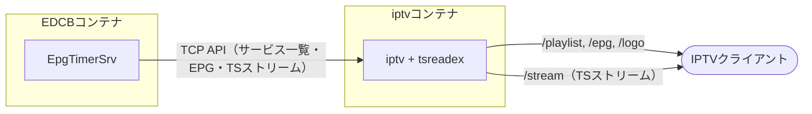
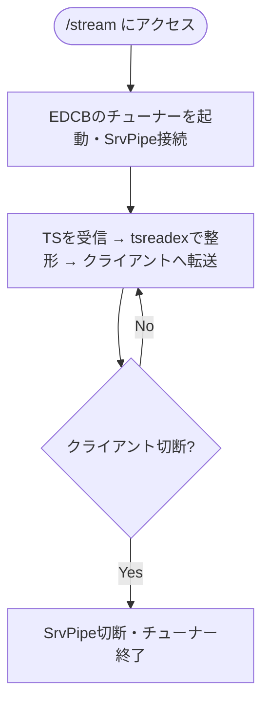

[](https://github.com/ka74mi/iptv/actions/workflows/ci.yml)

EDCB の TCP API を利用し、SrvPipe 経由で IPTV ストリームを配信するプロキシです。

M3U/XMLTV に対応した IPTV クライアントで利用できます。

なお、配信対象はデジタルTV（サービス種別 `0x01`）のみです。4K BS、ラジオ、データ放送は含まれません。

## 仕組み




## 前提条件
- Linux ネイティブ版 EDCB が動作していて EPG の取得が完了している
- スクランブル解除済みの TS ストリームを出力できる
- EpgTimerSrv の TCP API (port 4510) が有効になっている
- [設定メニュー] → [ネットワーク設定] → TCP 送信先に「SrvPipe」を追加している
- [設定メニュー] → [視聴に使用する BonDriver] で各 BonDriver を追加している

## 導入方法
### イメージのビルド
```bash
git clone --depth 1 https://github.com/ka74mi/iptv
cd iptv
podman build -t iptv .
```

### 環境変数
| 変数名 | 説明 | デフォルト | 
|--------|------|------------|
| `EDCB_HOST` | EDCB のホスト名または IP アドレス | `edcb` |
| `EDCB_PORT` | EDCB の TCP API ポート番号 | `4510` |
| `MAX_STREAMS` | 同時に配信できるストリーム数の上限。超過したリクエストは 503 を返します。EDCB で同時に使えるチューナー数に合わせてください | `4` |
| `REFRESH_INTERVAL` | サービス一覧・ロゴをEDCBから再取得する間隔。`0` で自動更新を無効化します。取得に失敗しても直前の内容を使い続けます | `1h` |
| `EPG_CACHE_TTL` | `/epg`（XMLTV）の生成結果をキャッシュする時間。`0` でキャッシュしません。EDCBに接続できない間は、期限切れでも最大1時間は前回の結果を返します | `5m` |
| `LOG_LEVEL` | ログのレベル（`debug`、`info`、`warn`、`error`）。`debug` ではチューナーの起動・終了や SrvPipe 接続のリトライも出力します | `info` |
| `LOG_FORMAT` | ログの形式。（`text`、`json`） | `text` |
| `LISTEN_ADDR` | HTTP サーバーの待ち受けアドレス（`host:port`）。コンテナ内のアドレスなので通常は変更不要で、公開側のポートは `-p` で指定します | `:8080` |
| `BASE_URL` | IPTV クライアントから到達できるこのプロキシの URL（http:// または https:// から始める必要があります）| `http://localhost:8080` |

### コンテナの起動
#### podman run

```bash
podman run -d \
  --name iptv \
  --network <EDCB と同じネットワーク> \
  -p 8080:8080 \
  -e EDCB_HOST=<EDCB のホスト名または IP> \
  -e BASE_URL=http://<このプロキシの IP またはホスト名>:8080 \
  iptv
```

#### Podman Quadlet
```ini
# ~/.config/containers/systemd/iptv.container

[Unit]
Description=edcb-iptv-proxy
After=edcb.service
Requires=edcb.service

[Container]
Image=localhost/iptv:latest
ContainerName=iptv
Network=<EDCB と同じネットワーク>
PublishPort=8080:8080
Environment=EDCB_HOST=<EDCB のホスト名または IP>
Environment=BASE_URL=http://<このプロキシの IP またはホスト名>:8080
HealthCmd=CMD /usr/local/bin/healthcheck
HealthInterval=30s
HealthTimeout=5s
HealthRetries=3
HealthStartPeriod=10s

[Service]
Restart=on-failure

[Install]
WantedBy=default.target
```

## IPTV クライアントへの設定
```
M3U:   <BASE_URL>/playlist
XMLTV: <BASE_URL>/epg
```

## セキュリティ
このツールはローカルネットワーク (LAN) 内での利用を想定しています。

外部からアクセスする場合は VPN の利用を推奨します。

リバースプロキシと同じマシンで動かす場合は、公開ポートをループバックに絞るとプロキシを経由しない直接アクセスを防げます（`-p 127.0.0.1:8080:8080` / `PublishPort=127.0.0.1:8080:8080`）。

## 開発について
このプロジェクトは Claude を利用したバイブコーディングによって開発されています。

## 免責事項
動作の正確性・安全性について作者は責任を負いません。自己責任でご利用ください。

## ライセンス
[MIT License](LICENSE)

## 謝辞
TCP API を通じた EDCB 連携は、xtne6f 氏による EDCB およびその TCP API の実装があって初めて成立しています。

また、同氏が開発する [tsreadex](https://github.com/xtne6f/tsreadex) を TS ストリームの音声処理に利用しています。

ストリーム配信におけるシーケンス部の実装にあたって、[KonomiTV](https://github.com/tsukumijima/KonomiTV) のソースコードを参考にさせていただきました。

